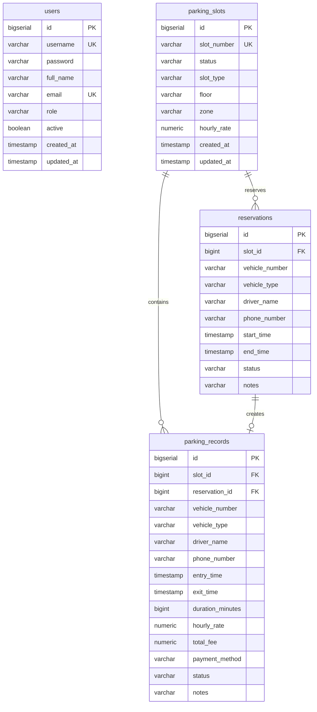

# 🚗 ParkFlow™ - Vehicle Parking Slot Management System
### Enterprise Full-Stack Commercial Parking Management & DevOps Platform

[](https://www.oracle.com/java/)
[](https://spring.io/projects/spring-boot)
[](https://react.dev/)
[](https://vitejs.dev/)
[](https://tailwindcss.com/)
[](https://www.postgresql.org/)
[](https://www.docker.com/)
[](https://www.terraform.io/)
[](https://prometheus.io/)

ParkFlow is a full-stack, enterprise-grade Vehicle Parking Slot Management System engineered for commercial facilities, office buildings, shopping malls, and multi-tenant parking garages. Built with a **Spring Boot 3.3 (Java 21)** REST API backend and a **React 18 + Vite + Tailwind CSS** frontend, it delivers visual bay mapping, atomic vehicle check-in and checkout, collision-free slot reservations, audit reporting, and DevOps automation.

---

## 📑 Table of Contents
1. [Key Features & Modules](#-key-features--modules)
2. [Technology Stack](#-technology-stack)
3. [Architecture & Visual Layout](#-architecture--visual-layout)
4. [Quick Start (Local Development)](#-quick-start-local-development)
   - [Option A: Docker Compose (All Services)](#option-a-docker-compose-recommended)
   - [Option B: Manual Development Mode](#option-b-manual-development-mode)
5. [Default User Credentials](#-default-user-credentials)
6. [REST API Documentation](#-rest-api-documentation)
7. [DevOps Infrastructure & CI/CD](#-devops-infrastructure--cicd)
   - [Terraform AWS Provisioning](#1-terraform-aws-provisioning)
   - [Ansible Server Configuration](#2-ansible-server-configuration)
   - [Jenkins Declarative CI/CD Pipeline](#3-jenkins-declarative-cicd-pipeline)
   - [Prometheus & Grafana Monitoring](#4-prometheus--grafana-monitoring)
8. [Database Schema](#-database-schema)

---

## 🌟 Key Features & Modules

### A. Executive Admin Dashboard
- **Live Metrics**: Total Slots, Available Slots (Green), Occupied Slots (Red), Reserved Slots (Orange), Vehicles Parked, Today's Entries, Today's Exits, and Overall Occupancy Rate.
- **Dynamic Charts**:
  - 7-Day Inbound vs Outbound Traffic (Area Chart with Recharts)
  - Slot Status Distribution (Interactive Donut Chart)
  - Vehicle Type & Zone Occupancy Breakdown (Bar Charts)
- **Live Activity Feed**: Real-time event log of check-ins, exits, and bookings.
- **Quick Action Shortcuts**: Instant access to Park, Exit, and Reserve actions.

### B. Interactive Visual Parking Bay Layout
- **Visual Parking Bays**: Color-coded cards reflecting physical layout with bay number (`A-01`, `B-02`, etc.), status, vehicle category icon, registration plate badge, and elapsed duration.
- **Floor & Zone Filters**: Filter bays across Ground Floor (Zone A & B), Level 1 (Zone C / EV), and Basement (VIP Zone).
- **Slot CRUD**: Add new bays, edit hourly rates/zones, and safely delete unutilized slots (deletion is prevented if actively parked or reserved).

### C. Inbound Vehicle Entry & Check-In
- Plate number format validation (`^[A-Z0-9 -]{4,20}$`).
- Category selection: **Car / Sedan**, **Bike / Two-Wheeler**, **EV (Electric Charging)**, and **Truck**.
- **Dynamic Bay Picker**: Shows only currently AVAILABLE slots matching the chosen category.
- **Anti-Duplicate Check**: Prevents admitting vehicles that are already recorded as parked.
- **Digital Parking Slip**: Automatically generates a printable ticket with reference code, QR/barcode simulation, entry timestamp, and bay assignment.

### D. Outbound Vehicle Exit & Automated Checkout
- **Instant Search**: Search parked vehicles by license plate, slot number, or driver name.
- **Real-Time Duration & Tariff Calculation**: `billedHours = Math.ceil(minutes / 60) * hourlyRate`.
- **Payment Settlement**: Select Cash, Credit Card, or UPI / Digital Corporate Pass.
- **Exit Receipt**: Automatically prints/saves receipt and frees the parking bay back to `AVAILABLE`.

### E. Advance Slot Reservations
- Book bays in advance with start/end timestamps and driver contact details.
- **Collision Prevention**: SQL query ensures no overlapping active bookings for the same bay.
- **One-Click Check-In**: Converts an arrival reservation directly into an active parking session.
- **Reservation Cancellation**: Restores bay to available if reserved within the active time window.

### F. Historical Audit Ledger & Reporting
- Audit log of all completed and active parking sessions.
- Multi-parameter filtering: Date range (Today, 7 days, 30 days, All) and Status (`PARKED`, `COMPLETED`).
- Pagination with customizable page sizes.
- **One-Click CSV Export**: Download facility ledger as `.csv` for accounting and analytics.

### G. User Access & Security Control (Admin Only)
- Role-based authorization: **ADMIN** vs **STAFF**.
- User roster with full name, email, role, and active status.
- Add user modal with BCrypt password hashing.
- One-click account activation/deactivation toggle.

---

## 🛠 Technology Stack

| Layer | Technologies |
|---|---|
| **Frontend** | React 18, Vite 5, Tailwind CSS 3.4, React Router 6, Lucide React, Recharts |
| **Backend** | Java 21, Spring Boot 3.3.4, Spring Web, Spring Data JPA, Spring Security 6 |
| **Security** | JSON Web Tokens (JJWT 0.12.5), BCrypt Password Hashing, CORS, Role-based auth |
| **Database** | PostgreSQL 16 (production), H2 Database (in-memory test profile) |
| **Containers** | Docker multi-stage builds (Eclipse Temurin 21 JRE, Nginx 1.27 Alpine) |
| **Orchestration**| Docker Compose (Postgres, Backend, Frontend, Prometheus, Grafana) |
| **DevOps** | Terraform (AWS VPC, EC2, RDS), Ansible, Jenkinsfile CI/CD |
| **Observability**| Spring Boot Actuator, Micrometer, Prometheus 2.54, Grafana 11.2 |

---

## 🚀 Quick Start (Local Development)

### Option A: Docker Compose (Recommended)
Spins up PostgreSQL, Spring Boot backend, React Nginx frontend, Prometheus, and Grafana in a single command:

```bash
# Navigate to project root
cd vehicle-parking-devops

# Build and start all 5 containerized services
docker compose up -d --build

# View running containers and health status
docker compose ps
```

Access the services:
- **Frontend Web Dashboard**: [http://localhost:3000](http://localhost:3000)
- **Spring Boot REST API**: [http://localhost:8080/api](http://localhost:8080/api)
- **Actuator Health Endpoint**: [http://localhost:8080/api/health](http://localhost:8080/api/health)
- **Prometheus Metrics**: [http://localhost:9090](http://localhost:9090)
- **Grafana Dashboards**: [http://localhost:3001](http://localhost:3001) *(login: `admin` / `admin123`)*

---

### Option B: Manual Development Mode

#### 1. Start Backend (Spring Boot with In-Memory / Local DB)
```bash
cd backend

# Build and test
mvn clean test

# Run Spring Boot (uses local PostgreSQL or H2 profile)
mvn spring-boot:run
# OR run with H2 in-memory profile:
mvn spring-boot:run -Dspring-boot.run.profiles=h2
```
The API server starts on `http://localhost:8080`.

#### 2. Start Frontend (React + Vite)
```bash
cd frontend

# Install dependencies
npm install

# Start Vite dev server with proxy to backend
npm run dev
```
Open your browser at [http://localhost:5173](http://localhost:5173).

---

## 🔐 Default User Credentials

On first run, the database automatically seeds with default accounts:

| Username | Password | Full Name | Role | Permissions |
|---|---|---|---|---|
| `admin` | `admin123` | System Administrator | **ADMIN** | Full administrative rights, user CRUD, slot deletion |
| `staff` | `staff123` | Sarah Jenkins | **STAFF** | Vehicle entry, checkout, reservations, slot view |

> *Tip: The Login page includes quick 1-click credential auto-fill buttons for both Admin and Staff.*

---

## 📡 REST API Documentation

All protected endpoints require an `Authorization: Bearer <token>` header obtained from `/api/auth/login`.

### Authentication & Users
| Method | Endpoint | Access | Description |
|---|---|---|---|
| `POST` | `/api/auth/login` | Public | Authenticate user and receive JWT token |
| `GET` | `/api/auth/me` | Authenticated | Retrieve authenticated user profile |
| `GET` | `/api/users` | Admin | List all registered system users |
| `POST` | `/api/users` | Admin | Create a new user account |
| `PUT` | `/api/users/{id}` | Admin | Update user information and role |
| `PATCH` | `/api/users/{id}/toggle-status` | Admin | Toggle active/deactive status |

### Parking Slots
| Method | Endpoint | Access | Description |
|---|---|---|---|
| `GET` | `/api/slots` | Authenticated | List slots with filters (`status`, `slotType`, `floor`, `zone`, `search`) |
| `GET` | `/api/slots/available` | Authenticated | Get currently available bays (optional `slotType`) |
| `GET` | `/api/slots/metadata` | Authenticated | Retrieve list of distinct floors and zones |
| `GET` | `/api/slots/{id}` | Authenticated | Get slot details by ID |
| `POST` | `/api/slots` | Authenticated | Create a new parking bay |
| `PUT` | `/api/slots/{id}` | Authenticated | Update parking bay details |
| `DELETE` | `/api/slots/{id}` | Admin | Delete slot (fails if occupied/reserved) |

### Vehicle Operations
| Method | Endpoint | Access | Description |
|---|---|---|---|
| `POST` | `/api/vehicles/entry` | Authenticated | Record vehicle check-in and assign bay |
| `PUT` | `/api/vehicles/exit` | Authenticated | Process vehicle checkout, calculate fee, free bay |
| `GET` | `/api/vehicles/current` | Authenticated | Get all vehicles currently parked in facility |
| `GET` | `/api/vehicles/history` | Authenticated | Paginated audit ledger with date and status filters |

### Reservations
| Method | Endpoint | Access | Description |
|---|---|---|---|
| `POST` | `/api/reservations` | Authenticated | Book a slot in advance with collision check |
| `GET` | `/api/reservations` | Authenticated | List all reservations (optional `status`) |
| `PUT` | `/api/reservations/{id}/cancel` | Authenticated | Cancel a reservation and restore slot |
| `POST` | `/api/reservations/{id}/checkin` | Authenticated | Check in reserved vehicle directly |

### Analytics & Health
| Method | Endpoint | Access | Description |
|---|---|---|---|
| `GET` | `/api/dashboard/stats` | Authenticated | Live KPIs (total, available, occupied, entries, exits) |
| `GET` | `/api/dashboard/occupancy`| Authenticated | Status distribution, vehicle type counts, zone breakdown |
| `GET` | `/api/dashboard/traffic` | Authenticated | 7-day daily traffic flow |
| `GET` | `/api/dashboard/activities`| Authenticated| Recent 10 audit activity logs |
| `GET` | `/api/health` | Public | System liveness health check |
| `GET` | `/actuator/prometheus` | Public | Prometheus scraping endpoint |

---

## ☁️ DevOps Infrastructure & CI/CD

### 1. Terraform AWS Provisioning
Directory: `terraform/`
Provisions an enterprise AWS environment:
- **VPC** (`10.0.0.0/16`) with public and private subnets across multiple availability zones.
- **Security Groups**:
  - `app-sg`: Permits HTTP (`80`, `3000`), API (`8080`), and SSH (`22`).
  - `db-sg`: Strictly restricts PostgreSQL (`5432`) to connections originating from `app-sg`.
- **EC2 Instance**: Ubuntu 22.04 with automated Docker and Docker Compose installation via `user_data`.
- **AWS RDS PostgreSQL**: Multi-AZ capable database in private subnet.
- **Elastic IP**: Static public IP for the application host.

```bash
cd terraform
cp terraform.tfvars.example terraform.tfvars
terraform init
terraform plan
# terraform apply (when ready to provision AWS)
```

### 2. Ansible Server Configuration
Directory: `ansible/`
Automates host preparation and deployment:
- Configures firewall rules (`ufw`).
- Installs Docker Engine and Docker Compose V2.
- Deploys application stack and monitors health checks.

```bash
cd ansible
ansible-playbook -i hosts.ini playbook.yml
```

### 3. Jenkins Declarative CI/CD Pipeline
File: `jenkins/Jenkinsfile`
Automated pipeline workflow:
1. **Checkout**: Polls Git repository for branch changes.
2. **Backend**: Runs `mvn clean test package` and archives JUnit test reports.
3. **Frontend**: Executes `npm ci` and `npm run build`.
4. **Docker Build**: Builds multi-stage images for backend and frontend tagged with build number and commit SHA.
5. **Docker Push**: Pushes release images to Docker Hub or AWS ECR.
6. **Deploy**: Invokes Docker Compose stack deployment on staging/production host.

### 4. Prometheus & Grafana Monitoring
Directory: `monitoring/`
- Prometheus scrapes `/actuator/prometheus` every 5 seconds.
- Pre-provisioned Grafana dashboard (`parkflow-overview`) visualizes:
  - API Request Throughput (Req/Sec by URI)
  - HTTP Request Max Latency
  - JVM Heap and Non-Heap Memory Allocation
  - CPU Usage (System vs Process)
  - Active HikariCP Database Connections

---

## 🗄 Database Schema

The PostgreSQL database (`parking_db`) consists of 4 relational tables:



---

## 📄 License
This project is licensed under the MIT License.
